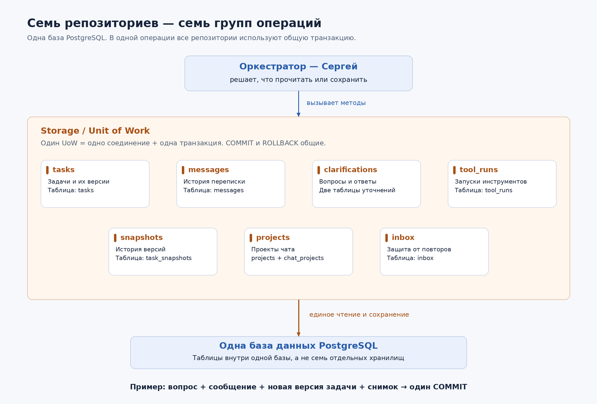
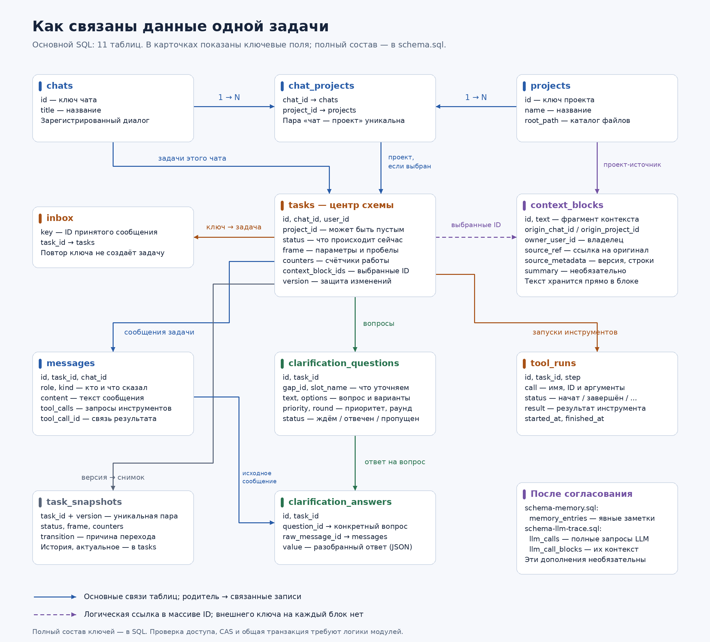

# Семь репозиториев: что это и как они используются

Это дополнительное пояснение. Основные решения и границы первой версии собраны в [документации MVP](storage-design.md).

Репозиторий здесь — часть будущего Storage, которая умеет читать и записывать определённую группу данных. Например, репозиторий задач знает, как сохранить Task в PostgreSQL и как восстановить Task из строки таблицы.

Семь репозиториев работают с одной базой. Для одной операции оркестратор получает их через общий Unit of Work — объект, объединяющий работу в одну транзакцию.

[Открыть масштабируемую SVG-версию](diagrams/repositories.svg).

## Почему их семь

Такой интерфейс уже предложен Сергеем в [API Storage](storage-context-engine-api.pdf). Число отражает группы операций, которые нужны оркестратору. Оно не означает семь баз данных, серверов или обязательных отдельных файлов.

| Доступ в Unit of Work | С чем работает | Что просит оркестратор | Таблицы |
| --- | --- | --- | --- |
| `tasks` — TaskRepo | Текущее состояние задачи | Создать задачу, найти активную задачу чата, прочитать или обновить задачу с проверкой версии | `tasks` |
| `messages` — MessageRepo | Рабочая переписка | Добавить сообщение, загрузить историю задачи, получить последние сообщения чата | `messages` |
| `clarifications` — ClarificationRepo | Уточняющие вопросы и ответы | Сохранить вопросы, прочитать ответы, пометить вопрос отвеченным или пропущенным | `clarification_questions`, `clarification_answers` |
| `tool_runs` — ToolRunRepo | Фактические запуски инструментов | Зафиксировать начало запуска, сохранить результат, найти незавершённые запуски | `tool_runs` |
| `snapshots` — SnapshotRepo | История версий задачи | Добавить снимок, прочитать последовательность снимков | `task_snapshots` |
| `projects` — ProjectRepo | Зарегистрированные проекты | Получить проект по ID или список проектов, привязанных к чату | `projects`, `chat_projects` |
| `inbox` — InboxRepo | Уже принятые сообщения | Узнать, обрабатывался ли `client_message_id`, и запомнить соответствующую задачу | `inbox` |

Один репозиторий может использовать несколько таблиц. Например, `clarifications` объединяет вопросы и ответы, поскольку они относятся к одному процессу уточнения.

## Как проходит обычный вызов

Допустим, оркестратору нужна текущая задача. Он передаёт `task_id` в метод `tasks.get`. Дальше будущий репозиторий:

1. Читает строку таблицы `tasks` по этому ID.
2. Превращает колонки и вложенные JSON-данные в общую модель Task.
3. Возвращает объект оркестратору; если записи нет — возвращает `None`.

Оркестратор работает с Task, а не со строками SQL. При записи путь обратный: он передаёт модель, репозиторий сохраняет её поля в таблицу. Поэтому можно изменить внутреннее устройство хранения, сохранив тот же интерфейс для Сергея.

Бизнес-решения остаются у оркестратора: например, именно он решает, что задача должна перейти в `waiting_user`. Репозиторий задач обеспечивает корректную запись этого решения, включая проверку версии.

## Зачем нужен общий Unit of Work

Представь, что Родион вернул вопрос «Какой проект проверить?». Оркестратору нужно одновременно сохранить четыре вещи:

| Порядок | Репозиторий | Что сохраняется |
| --- | --- | --- |
| 1 | `clarifications` | Структурированный вопрос: ID, текст, варианты, слот `project_id`, раунд |
| 2 | `messages` | Сообщение ассистента с текстом вопроса для истории переписки |
| 3 | `tasks` | Новый статус `waiting_user`, увеличенные счётчики и версия задачи |
| 4 | `snapshots` | Снимок сохранённой версии |

Эти четыре обращения выполняются в одном Unit of Work, на одном соединении с PostgreSQL:

- Все операции успешны — изменения фиксируются одним `COMMIT`.
- Одна операция завершилась ошибкой — все изменения откатываются одним `ROLLBACK`.

Так не получится сохранить статус ожидания и потерять сам вопрос. Репозитории не делают отдельный коммит после каждого своего метода: момент общего коммита задаёт Unit of Work.

Вызов модели, ожидание ответа пользователя и запуск инструмента происходят вне этой транзакции.

## Зачем вопрос хранится и в вопросах, и в сообщениях

В `clarification_questions` вопрос хранится как объект: какой параметр уточняет, каков его статус, какие есть варианты, на каком раунде задан. Эти данные нужны для обработки ответа и аналитики.

В `messages` хранится то, что было сказано в диалоге. Оно нужно, чтобы восстановить переписку для пользователя и модели. В одном сообщении может быть сразу несколько вопросов.

То же относится к ответу: исходное «backend, только модульные тесты» — одно сообщение. Из него можно извлечь два структурированных ответа на разные вопросы. В `clarification_answers.raw_message_id` сохраняется ссылка на оригинал.

## Чем запуск инструмента отличается от сообщения

`messages` содержит диалоговый запрос модели: «вызови read_file», а затем результат для следующего обращения к модели.

`tool_runs` содержит журнал реального выполнения: запуск начат, на каком шаге, с какими аргументами, чем закончился. По нему видно, что процесс упал во время запуска. У записи может остаться статус `started`, пока оркестратор не выполнит восстановление.

## Где Context Engine среди этих семи репозиториев

Context Engine — отдельный модуль с методом `gather`, который оркестратор вызывает наряду со Storage. Оркестратор не получает восьмой обязательный репозиторий контекста в описанном Unit of Work.

Context Engine может использовать внутренние средства хранения для чтения разрешённых сообщений, заметок и метаданных, а также записи `context_blocks`. Устройство этих внутренних обращений ещё предстоит определить при реализации. Файлы проекта он читает из каталога проекта.

В основной SQL-схеме есть и служебные данные, для которых в этих семи интерфейсах нет самостоятельного репозитория:

- `chats` — зарегистрированные чаты; процедуры создания в рабочем API пока нет.
- `context_blocks` — фрагменты, выбранные Context Engine.

Заметки `memory_entries` и полные вызовы `llm_calls` вынесены в необязательные SQL-дополнения: их назначение и канал записи ещё нужно согласовать.

## Как читать схему базы

[Открыть масштабируемую SVG-версию](diagrams/storage-schema.svg).

Основные связи:

1. Чат и проект связаны через `chat_projects`: у одного чата может быть несколько проектов, и один проект может использоваться в разных чатах.
2. `tasks` — центр обработки запроса. Одна задача относится к одному чату; проект может быть ещё не выбран.
3. Сообщения, вопросы, ответы, запуски инструментов и снимки относятся к задаче через `task_id`.
4. Ответ связан и с конкретным вопросом, и с исходным сообщением пользователя.
5. `inbox` связывает ключ принятого сообщения с задачей. Это защита от повторов, а не очередь задач.
6. Блок контекста хранит текст и происхождение. Список выбранных блоков записан в `tasks.context_block_ids`.

Сплошные связи на картинке показывают основные связи таблиц. Пунктир от задачи к контексту — ссылки в массиве ID, без внешнего ключа на каждый элемент. Картинка не показывает каждый дополнительный FK: полный состав ключей находится в SQL.

## Какие SQL-файлы подготовлены

| Файл | Содержимое | Статус |
| --- | --- | --- |
| [schema.sql](schema.sql) | 11 основных таблиц для Storage и блоков Context Engine, ограничения и индексы | Основной проект под описанный API |
| [schema-memory.sql](schema-memory.sql) | Таблица явных заметок `memory_entries` | Необязательное предложение; формат памяти и запись не утверждены |
| [schema-llm-trace.sql](schema-llm-trace.sql) | `llm_calls`, `llm_call_blocks`, дополнительная связь запуска инструмента с LLM-вызовом | Необязательное предложение; нужен интерфейс трассировки |

Память и трассировка независимы друг от друга; каждое дополнение предполагает наличие основной схемы. Корневой [schema.sql](../../schema.sql) остаётся исходным черновиком из разговора; новый проект лежит в папке хранения.

Сейчас подготовлены только определения структуры. Они не применены к PostgreSQL. Код Storage, Context Engine и оркестратора не добавлен; переход к реализации остаётся за тобой.

## Что SQL обеспечивает, а что остаётся за будущим кодом

| Обеспечивает схема БД | Требует логики модулей |
| --- | --- |
| Уникальные ID, допустимые статусы и базовые типы JSON | Полная проверка моделей и допустимых переходов между статусами |
| Не более одной активной задачи на чат | Обновление по ожидаемой версии — CAS |
| Ответ и его вопрос/сообщение принадлежат одной задаче | Сохранение всех нужных записей в одной транзакции |
| Уникальный ключ `inbox` | Возврат дубликата после конкурентного конфликта ключа |
| Уникальный снимок на версию | Создание снимка при каждом обновлении и запрет его изменения |
| Наличие записей, на которые указывают внешние ключи | Права доступа, проверка пути файла, существование ID блоков в массиве |

Открытые вопросы перечислены в [документации MVP](storage-design.md#11-что-ещё-согласовать). Наполнение памяти и полная трассировка LLM вынесены за рамки первой версии; соответствующие SQL-файлы сохранены как возможные дополнения на будущее.
