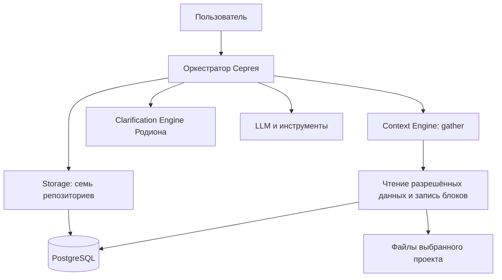
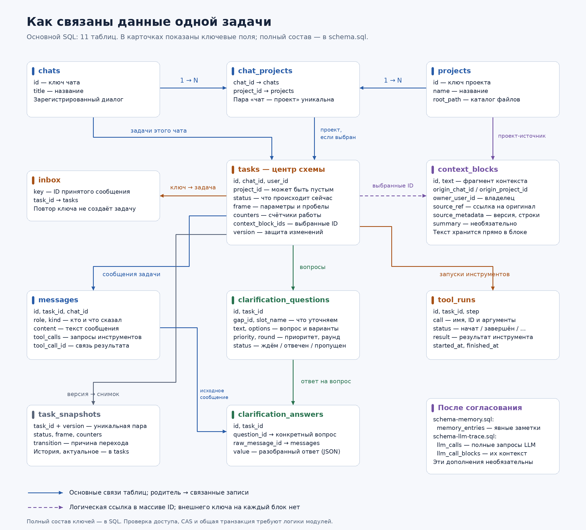

# Storage и Context Engine — документация MVP

Статус: проект первой версии по [API Сергея](storage-context-engine-api.pdf). Здесь собраны требования API, предложенная структура и оставшиеся вопросы. Документ описывает будущую работу модулей; код не написан, SQL к базе не применён.

## 1. Что делаем в первой версии

Наша часть состоит из двух модулей:

| Модуль | Ответственность |
| --- | --- |
| **Storage** | Читает и сохраняет задачи, переписку, уточнения, проекты и результаты работы |
| **Context Engine** | Находит полезные сведения в разрешённых источниках и возвращает пакет контекста |

Оркестратор Сергея решает, что вызвать дальше, меняет состояние задачи и собирает итоговый запрос к LLM. Движок Родиона определяет пробелы и возвращает вопросы или решение выполнять. Он получает данные через оркестратор и сам не пишет в БД.

Для MVP используем одну PostgreSQL, одного пользователя и один процесс оркестратора. Отдельной таблицы `users` пока нет; `user_id` из API сохраняем. Проекты и их пути задаём при настройке окружения. Методы хранения и сбора контекста — асинхронные, чтобы ожидание операций не блокировало другие запросы.

В первую версию не включаем векторный поиск, автоматические summaries, отдельное хранилище текстов по хешу, полный журнал промптов LLM, очереди и многопользовательские права. Это не требуется для проверки основного сценария.

## 2. Как связаны модули

Оркестратор передаёт моделям данные через согласованные интерфейсы. Устройство SQL-таблиц скрыто в слое хранения. Context Engine может иметь внутренние операции чтения источников и записи блоков; новых обязательных репозиториев оркестратору для этого не добавляем.

## 3. Семь репозиториев Storage

Репозиторий — группа методов для чтения и записи определённых данных. Все семь работают с одной базой. Внутри одного Unit of Work они используют одно соединение и одну транзакцию.

| Репозиторий | Методы API | Таблицы |
| --- | --- | --- |
| `tasks` | `create`, `get`, `find_active_by_chat`, `update` | `tasks` |
| `messages` | `add`, `list_by_task`, `list_recent_by_chat` | `messages` |
| `clarifications` | `add_questions`, `list_questions`, `set_status`, `add_answers`, `list_answers` | `clarification_questions`, `clarification_answers` |
| `tool_runs` | `add`, `update`, `list_by_task` | `tool_runs` |
| `snapshots` | `add`, `list_by_task` | `task_snapshots` |
| `projects` | `get`, `list_by_chat` | `projects`, `chat_projects` |
| `inbox` | `get`, `put` | `inbox` |

При записи репозиторий переводит общую модель в поля таблицы; при чтении восстанавливает модель. Отсутствующая запись в одиночном поиске возвращается как `None`, пустая выборка — как пустой список.

Регистрация чатов, проектов и связей между ними выполняется отдельно при настройке. Дополнительный публичный API управления ими сейчас не проектируем.

## 4. Что хранится в базе

Основная схема — [schema.sql](schema.sql), **11 таблиц**. Она сохраняет модели API без отдельной таблицы на каждое вложенное поле.

| Таблица | Содержимое и основные связи |
| --- | --- |
| `chats` | ID и название чата |
| `projects` | ID, имя, `root_path` — путь к каталогу проекта |
| `chat_projects` | Уникальная пара `chat_id` и `project_id`: у чата может быть несколько проектов |
| `tasks` | Исходный запрос, чат, пользователь, необязательный проект, статус, `frame`, счётчики, ошибка, версия и ID контекста |
| `messages` | Переписка задачи: роли, виды сообщений, текст, запросы инструментов и ID вызова для результата |
| `clarification_questions` | Вопрос, задача, пробел, слот, варианты, приоритет, раунд и статус |
| `clarification_answers` | Разобранное JSON-значение, задача, вопрос и ID исходного сообщения пользователя |
| `tool_runs` | Задача, шаг, полный запрос инструмента, статус, результат и время выполнения |
| `task_snapshots` | Неизменяемая история версий: статус, `frame`, счётчики и причина перехода |
| `inbox` | Ключ принятого сообщения → ID задачи; защита от повторной обработки |
| `context_blocks` | Выбранный текст, источник, область происхождения, владелец и метаданные источника |

[SVG для масштабирования](diagrams/storage-schema.svg). Блок «После согласования» на картинке показывает возможные дополнения, которые не входят в основной MVP.

Все сообщения, вопросы, ответы, запуски и снимки относятся к задаче через `task_id`. Ответ связан и с вопросом, и с исходным сообщением той же задачи. Одно сообщение может содержать ответы на несколько вопросов.

### Состояние задачи

`tasks` — источник актуального состояния. `Task.frame` хранится целиком в JSONB и содержит цель, слоты со значениями и источниками, допущения и открытые пробелы. Отдельную изменяемую `task_parameters` не вводим. Сохраняем все `evidence` и другие поля общей модели.

Источники значений: `USER`, `TOOL`, `CONTEXT`, `ASSUMPTION`. Правила их применения принадлежат общим моделям и оркестрации. Storage сохраняет переданные данные без изменения смысла.

Действующий проект оркестратор берёт из слота `frame.slots.project_id`, а при его отсутствии — из `Task.project_id`. Context Engine получает уже выбранный ID в запросе. Нельзя считать, что поле задачи всегда автоматически синхронизировано со слотом.

Статусы задачи: `new`, `analyzing`, `waiting_user`, `executing`, `completed`, `failed`, `cancelled`. Статусы вопросов по сценариям PDF: `pending`, `answered`, `skipped`; перечисление нужно сверить с исходными контрактами. Статусы запуска инструмента: `started`, `succeeded`, `failed`, `interrupted`.

### Переписка и контекст

Роли сообщений: `user`, `assistant`, `tool`, `system`. Виды: `request`, `question`, `answer`, `tool_call`, `tool_result`, `final`, `error`, `note`. Запрос и результат инструмента сопоставляются по ID вызова.

`messages` хранит исходную переписку. `context_blocks` хранит отобранные фрагменты, показанные модели. Текст блока лежит непосредственно в таблице; файлы проекта остаются на диске. Изменённый текст источника получает новый блок, чтобы старый ID не начал обозначать другие сведения.

Оркестратор сохраняет выбранные ID в `Task.context_block_ids`. Это массив логических ссылок, без внешнего ключа на каждый элемент. Блоки сохраняются до выдачи ID и не удаляются рабочим API первой версии.

## 5. Гарантии Storage

1. **Общая транзакция.** Успешный выход из Unit of Work — `COMMIT`; исключение — `ROLLBACK` и передача ошибки вызывающему коду. Репозитории самостоятельно не делают коммиты.
2. **Версия задачи.** `tasks.update` записывает изменения только при совпадении ожидаемой `version`, увеличивает её на 1 и возвращает новый объект с новым `updated_at`. При несовпадении — `ConcurrencyError` и откат всей транзакции. Переданный объект не меняется.
3. **Одна активная задача на чат.** Частичный уникальный индекс запрещает две задачи, не завершённые как `completed`, `failed` или `cancelled`. Известный конфликт этого ограничения при создании преобразуется в `ConcurrencyError`.
4. **Порядок.** Все списки выдаются в порядке добавления. Для этого служит `seq`, для снимков — версия. Последние сообщения чата выбираются с конца, но возвращаются от старых к новым. Пропуски в `seq` допустимы.
5. **Без потерь.** Вложенные поля и JSON-значения сохраняются полностью. Чтение возвращает независимые модели. ID задаёт вызывающий; время хранится с часовым поясом и выдаётся в UTC.
6. **Повторы.** `inbox` сохраняется вместе с принятым сообщением. Повторный ключ не запускает повторную обработку. При конкурентном конфликте оркестратор после отката повторно читает `inbox`. Без `client_message_id` этой гарантии нет.
7. **История версий.** Каждое обновление Task сопровождается снимком в той же транзакции, даже если статус не изменился. Пара `(task_id, version)` уникальна.

Индексы и внешние ключи уже описаны в SQL. CAS, создание снимков, общие транзакции и обработка дубликатов потребуют логики модулей. Один столбец `version` не реализует CAS автоматически.

CAS защищает запись состояния; однократное выполнение внешнего действия между разными процессами он не гарантирует. Поэтому для MVP принят один процесс оркестратора с его блокировкой на задачу.

## 6. Какие записи сохраняются вместе

| Событие | Одна транзакция записи |
| --- | --- |
| Новый запрос | Задача, исходное сообщение, ключ `inbox` при наличии, начальный снимок |
| Вопрос пользователю | Вопросы, сообщение, обновлённая задача со статусом `waiting_user`, снимок |
| Ответ пользователя | Сообщение, `inbox`, разобранные ответы, статусы вопросов, новые слоты/статус задачи, снимок |
| Перед инструментом | Запрос инструмента и запись начала выполнения фиксируются до реального запуска |
| Результат инструмента | Результат запуска, сообщение `tool_result`, обновлённая задача, снимок |
| Завершение, ошибка, отмена | Итоговое/ошибочное сообщение по сценарию, закрытие открытых вопросов, задача, снимок |

Долгие вызовы LLM, инструментов и движков идут между короткими транзакциями оркестратора. Событие пользователю выдаётся после коммита. Context Engine может выполнять собственные короткие чтения и записи блоков.

## 7. Context Engine: вход и результат

Единственный внешний метод — `gather(query) → ContextBundle`. Он подбирает сведения и не меняет задачу, вопросы или слоты.

| Вход `ContextQuery` | Для чего |
| --- | --- |
| `task_id`, `user_id`, `chat_id` | Задача и границы доступа |
| `project_id` или `None` | Выбранный проект, если он известен |
| `text` | Что искать |
| `scopes` | Какие источники разрешено использовать |
| `token_budget` | Максимальный размер результата |

На выходе — структурированный объект `ContextBundle`, который при необходимости можно сериализовать в JSON:

- `blocks` — выбранные блоки;
- `total_tokens` — сумма токенов блоков;
- `truncated` — пришлось ли исключить подходящие фрагменты из-за бюджета.

У блока: `id`, `text`, `source(kind, ref)`, `score`, `tokens`, необязательный `summary` и предусмотренный API `sha256`. Для MVP `summary = None`. Открытый вопрос по SHA-256 указан ниже.

Ссылка на источник имеет вид `message:<id>`, `file:<путь>` или `memory:<id>`. Для файлов сохраняем проект и доступные детали фрагмента: относительный путь, строки, сведения о версии. `score` и `tokens` вычисляются для выдачи; постоянными свойствами блока в SQL они не являются.

Готовый промпт собирает оркестратор: инструкции, карточка задачи, контекст и история. Историю текущей задачи он загружает отдельно.

### Когда вызывается сбор

По API: при каждом входе в `analyzing` — бюджет 8 000 токенов; в `executing` результат используется из кеша на время запуска, а при отсутствии собирается заново. Инструменты `get_project_context` и `search_memory` используют бюджет 2 000 токенов. Собственный кеш движка в MVP не добавляем.

## 8. Простой сбор контекста для MVP

| Scope | Что разрешено брать |
| --- | --- |
| `chat` | Сообщения указанного чата, кроме сообщений текущей задачи |
| `project` | Разрешённые текстовые файлы выбранного проекта; без выбранного проекта область пропускается |
| `other_chats` | Сообщения других чатов общего выбранного проекта, с подтверждённой принадлежностью этому проекту |
| `memory` | Явно сохранённые доступные заметки; пока источник не наполнен, результат пустой |

В обычном анализе Сергея запрашиваются `chat`, `project`, `memory`. `other_chats` используется инструментом `search_memory`. Источник добавляется только если он указан в `scopes`.

Предложение для первой версии: пользователь задаётся конфигурацией; движок проверяет его соответствие задаче и чату. Поиск в других чатах ограничен общим выбранным проектом, без переходов через цепочки проектов. Если проект неизвестен, `other_chats` пропускается. Чужой проект не попадает в выдачу даже при одинаковом тексте.

Алгоритм:

1. Проверить вход и доступ, определить разрешённые источники.
2. Взять ограниченный набор кандидатов: последние подходящие сообщения, README и небольшие текстовые файлы выбранного проекта. Список файлов и лимиты задаются настройкой; для старта достаточно README.
3. Исключить текущую задачу и неподходящие источники. Разбить большие тексты на фрагменты со ссылками на оригинал.
4. Оценить совпадение слов с запросом, для сообщений учесть давность. Удалить точные дубли по согласованному правилу API.
5. Отсортировать по убыванию полезности и выбрать фрагменты в пределах бюджета.
6. Сохранить возвращаемые блоки и выдать пакет с ID и происхождением.

Сумма `block.tokens` равна `total_tokens` и не превышает бюджет. При пропуске подходящих кандидатов из-за бюджета `truncated = True`. Если совпадений нет — пустой пакет с `False`. Пустая выдача не доказывает, что ответа нет во всех файлах проекта.

Подсчёт токенов согласуется с LLM и форматом блока; приблизительной оценки по длине строки недостаточно для строгого лимита. Файловый поиск остаётся внутри реального корня проекта, включая проверку симлинков.

Отсутствие необязательного источника и отсутствие совпадений — штатные исходы. Неожиданное исключение из `gather` по текущему API переводит задачу в `failed(internal_error)`. Цель около 1 секунды — пожелание API, а не подтверждённый результат измерений.

## 9. Пауза, отмена и восстановление

В `waiting_user` цикл остановлен. Задача хранится в БД и продолжается после следующего сообщения пользователя.

При `resume` оркестратор читает текущую задачу, сообщения и запуски инструментов. Для незакрытых вызовов добавляет результат-ошибку и помечает начатые запуски как `interrupted`, затем продолжает цикл. Снимки используются для истории, восстановление идёт не из них.

Отмена сохраняется через CAS: поздняя запись со старой версией отклоняется. Другие ошибки Storage передаются наружу без самостоятельной смены статуса. Если исход коммита неизвестен из-за обрыва соединения, сначала перечитываются задача и `inbox`.

Инструменты описанного MVP только читают данные. Запуск тестов и другие действия с побочными эффектами требуют отдельного согласования поведения после сбоя.

## 10. Пример совместной работы

1. Пользователь просит найти команду тестов; в чате два проекта.
2. Оркестратор проверяет `inbox` и активную задачу, затем сохраняет новый запрос.
3. Context Engine собирает разрешённый контекст чата, не выбирая произвольно один из проектов.
4. Родион возвращает вопрос «Какой проект?». Оркестратор сохраняет вопрос, сообщение, статус ожидания и снимок одной транзакцией.
5. Пользователь отвечает «backend». Сохраняются исходное сообщение, разобранный ответ, слот `project_id` с источником `USER` и новая версия задачи.
6. Повторный `gather` получает выбранный backend и возвращает его README с происхождением.
7. Повторный анализ разрешает выполнение; оркестратор использует чтение/поиск и сохраняет результаты, итог и состояние задачи.

Запрос [Родиона к хранению](../question-generation/request-to-egor.md) укладывается в эту схему: история в порядке добавления, устойчивые ID, полные `frame/evidence`, исходные сообщения и несколько ответов на одно сообщение. Дополнительных таблиц для его модуля не требуется.

## 11. Что ещё согласовать

| Вопрос | Предложение для MVP |
| --- | --- |
| SHA-256 в API при прежнем отказе от хеширования | Без Git blob-хранилища; предложено оставить только контрольную сумму возвращаемого текста. Если убираем любое хеширование, меняем контракт с Сергеем |
| Кто задаёт проекты, связи и `root_path` | Участник, настраивающий локальное окружение, до обработки задач |
| Доступ к другим чатам | Общий выбранный проект; правило подтвердить с командой |
| Память | На старте без наполнения; запись заметок и их формат согласовать отдельно |
| Токены | Один согласованный счётчик и формат блока; уточнить включение подписей источника |
| Ключи `inbox` | Для текущего `get(key)` — глобально уникальные; поведение одинакового ключа с другим содержимым уточнить |
| Точные модели и статусы | Получить исходники `harness/contracts` и проверки Storage, упомянутые в PDF; здесь их пока нет |

Прототип и результаты тестов из PDF не считаются проверенными в этой копии. Срок реализации определяется после согласования оставшихся вопросов и отдельного решения перейти к коду.

## 12. Файлы и готовность первой версии

| Файл | Роль |
| --- | --- |
| [schema.sql](schema.sql) | Основной проект 11 таблиц, связей и индексов; только определения структуры |
| [SUMMARY.md](SUMMARY.md) | Краткий итог для обсуждения |
| [repositories.md](repositories.md) | Дополнительное объяснение репозиториев на примерах |
| [schema-memory.sql](schema-memory.sql) | Возможное дополнение для заметок, вне текущего MVP |
| [schema-llm-trace.sql](schema-llm-trace.sql) | Возможное дополнение для полных вызовов LLM, вне текущего MVP |

Корневой `schema.sql` — старый черновик из разговора. Основой текущего проекта является SQL в этой папке. Ни один файл не применён к базе.

Будущая реализация MVP готова к интеграции, когда проверены: сохранение моделей без потерь; откат общей транзакции; CAS и отмена; одна активная задача; повторы сообщений; порядок переписки и снимки; восстановление незакрытого инструмента; границы доступа, источники и бюджет контекста; сценарий «вопрос → ответ → повторный сбор → выполнение». Сейчас выполнено проектирование, а не эти проверки реализации.
