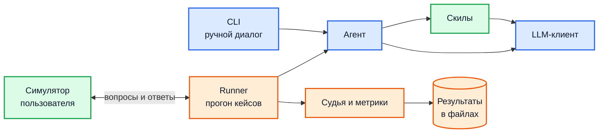
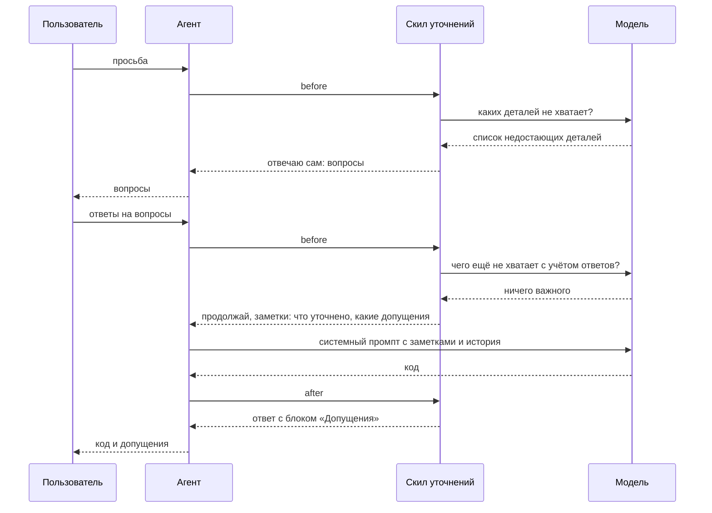

# Архитектура

## Задача

Мы пишем с нуля минимального агента, который по просьбе пользователя пишет код, и скил «спрашивай, а не додумывай».

Языковые модели на неполную просьбу обычно сразу выдают код и молча додумывают всё, чего в просьбе не было: язык, типы данных, формат результата и так далее. Если догадка не совпала с тем, что имел в виду пользователь, код приходится переделывать.

Скил меняет это поведение. Агент со скилом:

- задаёт вопросы, если не хватает деталей, которые сильно влияют на результат;
- не задаёт вопросов, если задача и так понятна или недостающее можно спокойно решить самому;
- явно перечисляет в ответе всё, что решил сам.

Вторая часть проекта — стенд, который измеряет, насколько скил улучшает поведение агента на разных моделях.

## Основные понятия

Эти слова используются во всех документах.

| Понятие | Что это |
| --- | --- |
| Модель, LLM | Языковая модель, к которой мы обращаемся по API: Qwen, DeepSeek, GPT, Claude и другие. Мы её не обучаем, а только вызываем |
| OpenRouter | Сервис, через который один и тот же код может вызывать модели разных компаний. Достаточно поменять название модели |
| Сообщение | Один элемент переписки, который передаётся модели. У сообщения есть роль и текст. Роли бывают три: `system` (инструкция для модели), `user` (реплика пользователя), `assistant` (реплика агента) |
| Системный промпт | Сообщение с ролью `system`, которое идёт первым. В нём написано, кто такой агент и как ему себя вести. Пользователь его не видит |
| История | Список всех сообщений пользователя и агента в текущем диалоге. Модель ничего не помнит между вызовами, поэтому при каждом вызове ей передаётся вся история |
| Токены | Единицы, в которых модель считает текст. За вызов модели платят по числу токенов на входе и на выходе |
| LLM-клиент | Наш класс, через который код вызывает модель. Принимает список сообщений, возвращает текст ответа и число потраченных токенов |
| Структурированный ответ | Режим вызова модели, при котором вместе с сообщениями передаётся JSON Schema, то есть описание, какие поля и каких типов должны быть в ответе. Модель обязана вернуть JSON ровно такой формы. Этот режим нужен, когда ответ модели разбирает код, а не читает человек. В LLM-клиенте за него отвечает параметр `json_schema` |
| Агент | Наш класс, который ведёт один диалог: хранит историю, вызывает скилы и модель, возвращает ответ |
| Ход | Обработка одного сообщения пользователя: от получения текста до возврата ответа агента |
| Скил | Подключаемый модуль, который меняет поведение агента. Агент ничего не знает о конкретных скилах, он только вызывает их в двух определённых местах хода. Эти места называются хуками |
| Хук `before` | Вызывается в начале хода, до обращения к модели. Скил может сам ответить пользователю, например задать вопросы, и тогда модель в этом ходе не вызывается. Либо скил пропускает ход дальше и при желании добавляет заметки |
| Хук `after` | Вызывается в конце хода, после ответа модели. Скил может поправить или дополнить ответ |
| Заметки | Короткие факты, которые скил передаёт модели. Агент добавляет их в системный промпт текущего хода. Так модель узнаёт, что выяснил скил |
| Состояние скила | Данные, которые скил хранит между ходами одного диалога. Например, какие вопросы он уже задал. У каждого скила своё состояние |
| Допущение | Деталь, которую агент решил сам, не спрашивая пользователя. Допущения нужно явно перечислить в ответе |
| Трасса | Журнал событий хода: что решил каждый скил, какие были вызовы модели, сколько ушло токенов и времени. Нужна для отладки и для подсчёта стоимости |
| Конфиг | Файл настроек в формате YAML (простой текстовый формат «ключ: значение»), который описывает вариант агента: какой системный промпт и какие скилы с какими параметрами включены |
| Тест кода | Обычный автоматический тест на `pytest`, который проверяет, что наш код работает без ошибок. Настоящую модель не вызывает |
| `FakeLLM` | Ненастоящая модель для тестов кода. Тест сам задаёт, что она ответит. Подробно в разделе «Как проверяем работу» |
| Тест-кейс | Задача для оценки скила, не путать с тестом кода. Содержит исходную просьбу пользователя, список критичных деталей, ответы пользователя на вопросы и способ проверить код. Набор кейсов и метрик взят из `skill_test_cases.md` |
| Симулятор пользователя | Модель, которая в автоматической проверке играет роль пользователя: отвечает на вопросы агента по данным из тест-кейса |
| Судья | Модель, которая после диалога его размечает: какие вопросы агента были по делу, какие лишние, какие детали он решил сам и сказал об этом, а какие решил молча |
| Метрики | Числа, которые код считает по разметке судьи. Показывают, насколько хорошо агент спрашивает |
| Прогон | Один полный диалог агента с симулятором по одному тест-кейсу и последующий подсчёт метрик |
| Runner | Программа, которая выполняет прогоны по всем тест-кейсам, конфигам и моделям и сохраняет результаты |
| Кэш ответов | Сохранённые на диск ответы модели. Если тот же запрос уже отправлялся, ответ берётся из кэша, и модель повторно не вызывается |

## Из чего состоит система

Синим отмечены части Сергея, зелёным части Родиона, оранжевым части Егора.

Агента можно запустить двумя способами:

1. Через консольную программу (CLI). Человек сам переписывается с агентом в терминале. Это нужно для отладки и ручной проверки.
2. Через runner. Он берёт тест-кейсы и по каждому проводит диалог агента с симулятором пользователя. Потом судья размечает диалог, код считает метрики, а результаты сохраняются в файлы.

В обоих случаях агент один и тот же и не знает, кто с ним разговаривает.

| Участник | За что отвечает | Документ |
| --- | --- | --- |
| Сергей | агент, LLM-клиенты, конфиги, консольная программа, подготовка репозитория и тестов | [orchestration.md](orchestration.md) |
| Родион | скил уточнений, его текстовая версия, симулятор пользователя | [clarification-skill.md](clarification-skill.md) |
| Егор | тест-кейсы, кэш ответов, runner, судья, метрики, хранение результатов | [evaluation.md](evaluation.md) |

Классы, через которые части системы общаются друг с другом, описаны в [contracts.md](contracts.md). Задачи каждого по порядку перечислены в [tasks.md](tasks.md).

## Как проходит ход

На каждое сообщение пользователя агент выполняет одни и те же шаги:

1. Добавляет сообщение пользователя в историю.
2. По очереди вызывает хук `before` у каждого включённого скила. Если какой-то скил ответил сам, его ответ добавляется в историю и возвращается пользователю. На этом ход заканчивается.
3. Если ни один скил не ответил сам, агент собирает сообщения для модели: системный промпт вместе с заметками скилов, затем вся история. После этого вызывает модель.
4. Передаёт ответ модели в хук `after` каждого скила, и каждый может его изменить.
5. Добавляет итоговый ответ в историю и возвращает его пользователю.

Так выглядит диалог, в котором скил уточнений сначала задаёт вопросы, а на следующем ходе пропускает агента к написанию кода:

## Как проводим эксперимент

Нужно понять не только, помогает ли скил, но и нужен ли для этого отдельный код, или хватит хорошо написанной инструкции в промпте. Поэтому сравниваем три конфига:

| Конфиг | Что включено | Что показывает |
| --- | --- | --- |
| `bare` | обычный системный промпт, скилов нет | как ведёт себя модель сама по себе |
| `prompt_only` | правила скила добавлены текстом в системный промпт, кода скила нет | помогает ли одна инструкция |
| `clarification` | скил уточнений в виде кода: отдельный анализ недостающих деталей, приоритет вопросов, лимиты | даёт ли код что-то сверх инструкции и сколько это стоит |

Модель в конфиг не входит, её указывают при запуске. Один эксперимент — это все тест-кейсы, прогнанные на нескольких конфигах и нескольких моделях. В результате получается таблица: каждая строка соответствует паре «модель и конфиг», каждый столбец — одной метрике.

## Как проверяем работу

В проекте две разные проверки, их легко перепутать. Они проверяют разное, запускаются в разное время и устроены по-разному.

| | Тесты кода | Оценка скила |
| --- | --- | --- |
| На какой вопрос отвечает | Программа написана без ошибок? | Насколько хорошо агент со скилом ведёт себя с пользователем? |
| Вызывается ли настоящая модель | Нет | Да |
| Сколько стоит | Бесплатно | Тратит деньги на вызовы моделей |
| Сколько длится | Секунды | От минут до часов |
| Когда запускается | Постоянно: у себя после любой правки и автоматически на GitHub при каждой отправке кода | Вручную, когда поменяли что-то в скиле или хотим проверить новую модель |
| Результат | Все тесты прошли или какой-то упал | Таблица метрик по моделям и вариантам агента |
| Чем запускается | `pytest` | runner, `evals/run.py` |

Слово «тест-кейс» относится только к оценке скила. Тест-кейс — это задача, на которой проверяется поведение агента, а не тест кода.

### Тесты кода

Это обычные автоматические тесты на `pytest`. Каждый тест вызывает какую-то функцию или класс и сверяет результат с ожидаемым.

Проблема в том, что почти всё в проекте обращается к модели, а ответы настоящей модели заранее неизвестны, стоят денег и каждый раз могут быть разными. Тест с таким ответом нельзя проверить. Поэтому в тестах вместо настоящей модели подставляется `FakeLLM`. Это ненастоящая модель: тест сам задаёт ей, что она ответит, а она запоминает, что ей отправили.

Тест с `FakeLLM` устроен так:

1. Тест создаёт `FakeLLM` и задаёт ответы, которые она вернёт по очереди.
2. Тест создаёт проверяемый объект, например агента или скил, и передаёт ему `FakeLLM` вместо настоящего LLM-клиента.
3. Тест вызывает проверяемый метод.
4. Тест сверяет результат с ожидаемым, а при необходимости смотрит, что именно объект отправил в `FakeLLM`.

Так проверяется логика нашего кода при любом ответе модели, в том числе при ответах, которые настоящая модель выдаёт редко: пустом, некорректном, с ошибкой.

Подставить `FakeLLM` получается только потому, что соблюдается одно правило: код, которому нужна модель, не создаёт LLM-клиент сам, а получает его параметром.

| Что проверяем | Что задаём `FakeLLM` | Что сверяем |
| --- | --- | --- |
| Агент | ответы модели, плюс простые тестовые скилы | хуки вызываются в правильном порядке, ответ скила прерывает ход, заметки попадают в системный промпт |
| Скил уточнений | готовый результат поиска недостающих деталей | какие вопросы скил задал или почему пропустил ход дальше |
| Формула приоритета, метрики | модель не нужна | это обычные функции, сверяем их результат с посчитанным вручную |
| Симулятор и судья | ответы модели-симулятора и модели-судьи | ответ правильно разбирается, диалог заканчивается вовремя |
| Вся цепочка оценки | ответы для агента, симулятора и судьи | один тест-кейс проходит через runner от начала до конца и даёт метрики |

### Оценка скила

Здесь, наоборот, нужны настоящие модели: мы хотим узнать, как они себя ведут. Runner берёт каждый тест-кейс и для каждого варианта агента и каждой модели делает следующее:

1. Создаёт агента с нужным конфигом и моделью.
2. Отправляет агенту исходную просьбу из тест-кейса.
3. Агент отвечает. Если он задал вопросы, на них отвечает симулятор пользователя по данным тест-кейса. Так продолжается, пока агент не пришлёт код или не будет достигнут лимит вопросов.
4. Судья читает диалог и размечает его: какие вопросы были по делу, какие лишние, о каких важных деталях агент не спросил и промолчал.
5. Код по разметке считает метрики и проверяет, работает ли присланный код.
6. Результаты записываются в файлы, а итоговая таблица печатается в консоль.

Подробности оценки в [evaluation.md](evaluation.md).

## Как расширять

| Что добавить | Что сделать |
| --- | --- |
| Новый скил | написать класс-наследник `Skill` в папке `skills/<имя>/`, добавить его в реестр скилов (словарь, по которому агент находит класс скила по имени из конфига), создать конфиг `configs/<имя>.yaml` и тест-кейсы в `evals/cases/<имя>/` |
| Новую модель | указать её название при запуске прогона |
| Инструменты, то есть возможность агента читать и писать файлы, запускать код | реализовать класс инструмента и цикл, в котором модель просит вызвать инструмент, агент его выполняет и возвращает результат модели. Это последний этап у Сергея в [tasks.md](tasks.md) |
| Новую метрику | функция в `evals/metrics.py` и новый столбец в итоговой таблице |

## Принятые решения

| Вопрос | Решение и причина |
| --- | --- |
| Брать ли LangChain или LangGraph | Нет. Агент занимает несколько десятков строк, а логику скила всё равно пишем сами. Фреймворк добавил бы больше сложности, чем сэкономил бы кода |
| Нужны ли инструменты | Не в первой версии. В тест-кейсах агент пишет код прямо в ответе, и проверяется этот текст. Инструменты добавим после того, как скил будет проверен |
| Какой контекст давать модели | Только историю текущего диалога. Файлы проекта и другие источники можно подключить позже отдельным скилом |
| Сколько вопросов задавать | Не больше 3 за раз и не больше 5 на одну задачу. Если недостающих деталей больше, спрашиваем о самых важных по формуле приоритета из [clarification-skill.md](clarification-skill.md) |
| Как не спрашивать то, что уже известно | Скил анализирует всю историю диалога, а не только последнее сообщение. Деталь, которую пользователь уже назвал, недостающей не считается |
| Подтверждать ли итоговое задание у пользователя перед написанием кода | Это опция скила, по умолчанию выключена. Подтверждение добавляет лишнее сообщение, поэтому включаем его отдельным экспериментом и смотрим, окупается ли оно |
| Использовать ли хеши для хранения контекста | Для контекста нет: хеш (короткая строка, вычисленная из текста) не сжимает смысл текста, и модели он бесполезен. Но по хешу запроса удобно находить сохранённый ответ в кэше |
| Нужна ли база данных | Нет. Результаты прогонов и кэш ответов хранятся в файлах |

## Что не делаем

Базу данных, сохранение диалогов между запусками, инструменты в первой версии, HTTP-сервер и пользовательский интерфейс. Подробная первая версия документации, где это всё было, лежит в ветке `archive/v1-docs`.
